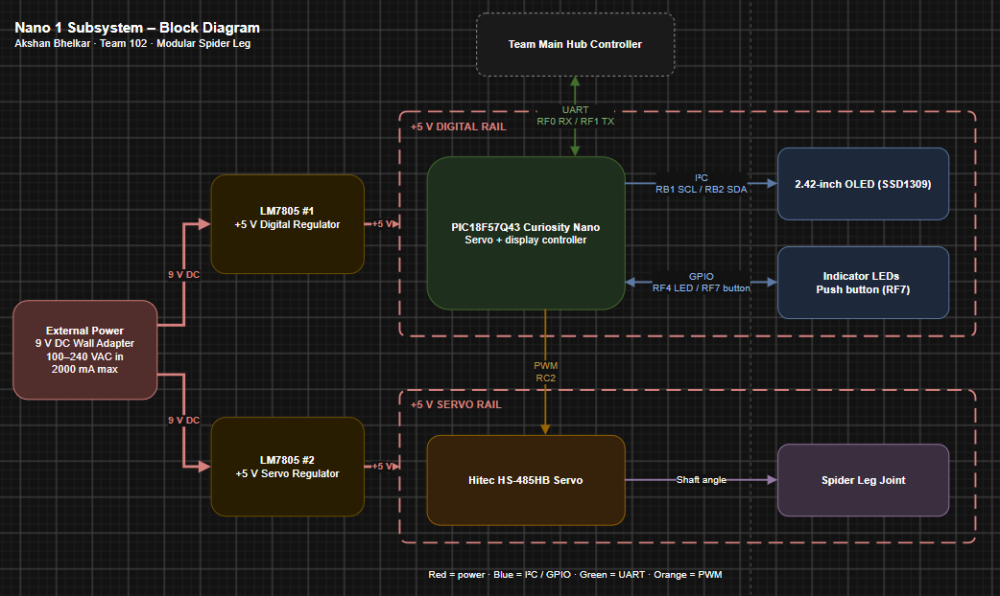

# Individual Block Diagram

## Overview
The purpose of this individual block diagram is to showcse the hardware architecture, electrical interfaces, and signal flow for the Servo Motor Subsystem of Team's Modular Spider Leg.

## System Architecture

- **Power Input:** The subsystem receives power from an external 9 V DC supply.

- **Main 5 V Supply:** An LM7805 regulator produces a regulated 5 V supply for the PIC development board, OLED display, debug LED, push button, and communication circuitry.

- **Servo 5 V Supply:** A second LM7805 provides a separate regulated 5 V rail for the Hitec HS-485HB servo. Separating the servo supply reduces the effect of the servo's high current demand and electrical noise on the microcontroller and OLED.

- **Microcontroller:** The PIC18F57Q43 acts as the controller. It receives position commands through UART, generates the PWM control signal for the servo, communicates with the OLED through I²C, and controls the debugging inputs and outputs.

- **Servo Control:** The Hitec HS-485HB servo receives a PWM signal from the PIC through RC2. The servo converts the commanded pulse width into the required angular position of the spider leg.

- **OLED Display:** The 2.42-inch 128 × 64 OLED connects to the PIC through the I²C interface. RB1 provides SCL and RB2 provides SDA. The display shows the commanded servo position, operating status, and diagnostic information.

- **Team Communication:** The subsystem connects to the main hub through the team's standard connector. RF0 is configured as UART RX to receive commands, while RF1 is configured as UART TX to return subsystem status.

- **Debugging Interfaces:** The RF4 debug LED provides a visible indication of program operation. The RF7 push button provides a manual test input, while the test points allow important power and signal nodes to be measured during troubleshooting.

## Design Decision

The subsystem uses a hub and spoke structure because it operates as one part of the team's larger modular spider leg system. 

The power section is divided into separate main and servo 5 V rails. The main LM7805 supplies the PIC, OLED, and debugging circuitry, while the second LM7805 supplies the Hitec HS-485HB servo. This separation reduces the possibility of the servo's high current demand and electrical noise interfering with the microcontroller or OLED.

## Subsystem Block Diagram

**Figure:** Current hardware block diagram showing the power distribution, PIC controller, communication interface, OLED display, and servo control connections for the modular spider leg subsystem. This diagram represents the current subsystem design and will be refined from feedback of the external design review.

