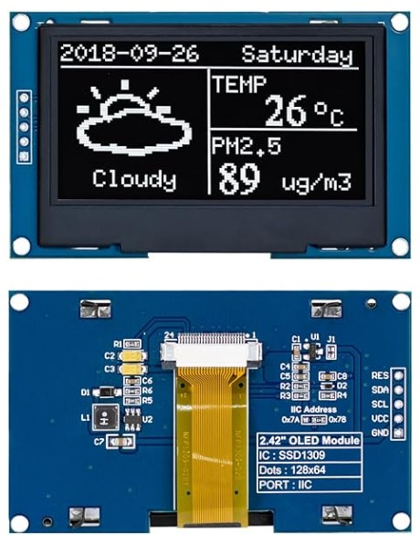
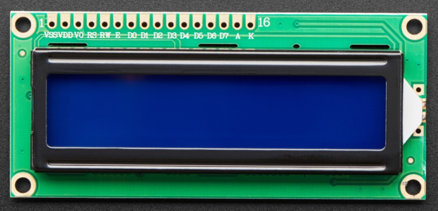

# Driver Nano 1 (Servo + Display)

This page covers the components for **Driver Nano 1**: the joint-1 servo and the diagnostic display. Driver Nano 1 receives target positions from the Main Processor Nano over the I2C, drives the joint, shows leg status on the display, and reports status back.

**Selection criteria used for both components**

* Runs from the 5 V logic domain used by the Nano.
* Has a manufacturer or available datasheet.
* Uses few Nano pins and little RAM.
* Does not use the Nano's hardware I2C pins (A4/A5), which are reserved for the command bus to the Main Nano.
  

---

**Hip Joint Servo (Rotary Actuator)**

1. Hitec HS-485HB standard analog servo

    

    * $28.99/each
    * [HS-485HB product page at Amzaon](https://a.co/d/0c83S3Ro)
    * [HS-485HB manufacturer datasheet](https://media.digikey.com/pdf/Data%20Sheets/Hi-Tech/HS-485HB.pdf)

    | Pros | Cons |
    | ---- | ---- |
    | Position control is built in: the internal potentiometer holds the commanded angle, so the Nano only outputs one 50 Hz PWM signal (Servo library, any digital pin) and no driver IC is needed. | Stall current is 1.0 A at 4.8 V and 1.2 A at 6 V per the datasheet, so the regulator and wiring must be sized for it, and the servo cannot be powered from the Nano's 5V pin or USB. |
    | Stall torque of 4.8 kgf·cm at 4.8 V and 6.0 kgf·cm at 6 V in a 45 g package gives the highest torque per gram of the three options. | Karbonite (plastic) gears can strip under shock loads such as a leg strike, and metal-gear servos cost more. |
    | It runs from the same 4.8–6 V range as the logic, and the manufacturer datasheet lists stall current, idle current, speed, and dimensions, which makes the power budget straightforward. | The servo gives no position output, so the Nano cannot confirm that the joint reached the angle. The status sent to the Main Nano is the commanded value, not a measured one. |

2. NEMA 17 bipolar stepper (17HS15-1704S) with DRV8825 stepper driver carrier

    

    * Motor: $9.98
    * [17HS4023S Stepper motor product page at Amazon](https://a.co/d/0dAFWEmr)
    * [17HS15-1704S full datasheet](https://www.laskakit.cz/user/related_files/73231_1624__ps_1199sm-17hs4023-etc.pdf)

    

    * Driver: $15.95
    * [DRV8825 driver product page at Pololu](https://www.pololu.com/product/2133)
    * [DRV8825 datasheet (Texas Instruments)](https://www.ti.com/lit/ds/symlink/drv8825.pdf)

    | Pros | Cons |
    | ---- | ---- |
    | The motor's rated current of about 0.7 A per phase is well under the DRV8825 carrier's roughly 1.5 A limit without a heat sink, so no extra cooling is needed. | Holding torque is only about 14 N·cm (roughly 1.4 kgf·cm), about a third of the HS-485HB's 4.8 kgf·cm at 4.8 V, so a gearbox would likely be needed for a hip joint, adding cost, backlash, and mass. |
    | The DRV8825 provides up to 1/32 microstepping from a 1.8° step motor, and the Nano only has to output STEP and DIR pulses with no PWM timing constraints. | The DRV8825 needs an 8.2–45 V motor supply (the motor is rated for 12 V), so it cannot run from the 5–6 V logic rail and adds a second power rail, regulator, and power budget line. |
    | The shaft holds position while the coils are energized with no gear train to strip, and the DRV8825 adds over-current protection, thermal shutdown, and an adjustable current limit. | It is open loop with no position feedback, so lost steps go undetected and the joint needs a homing switch at power-up, and the coils draw current continuously while holding. |

**Choice:** Option 1: Hitec HS-485HB standard servo

**Reason:** The HS-485HB is the best match for the Driver Nano 1 architecture. Its internal closed-loop position control means the Nano only needs one PWM pin and the standard Servo library, and it runs from the same 4.8–6 V supply as the rest of the subsystem. The stepper option (Option 2) is the most inexpensive motor, but the DRV8825 needs at least 8.2 V, which forces a second power rail and regulator, and the 280 g motor is about six times heavier than the servo for similar torque. 

---

**Diagnostic Display (leg status)**

1. 2.42 inches 128x64 IIC I2C OLED Display Module (Amazon)

    

    * Price: $15.59
    * [ 2.42 Inches I2C OLED Display Module on Amazon](https://a.co/d/0i3j9NDr)
    * [Oled Display Datasheet](https://manuals.plus/asin/B0G2RFLG1L.pdf)

    | Pros | Cons |
    | ---- | ---- |
    | Large 2.42-inch, 128×64 display provides clear text and enough space for angles, status, and fault messages. | The SSD1309 controller requires a compatible library and may not work correctly with every SSD1306 example.|
    | Uses only four I²C connections: VCC, GND, SDA, and SCL. | It is larger and more expensive than common 0.96-inch OLED modules. |
    | Supports 3–5 V power and provides bright, high-contrast graphics without a backlight. | Static images displayed for long periods can cause pixel dimming or burn in. |
   
2. Adafruit Standard 16×2 character LCD

    

    * Price: $9.95
    * [Adafruit Standard LCD 16×2 (ADA181) product page](https://www.adafruit.com/product/181)
    * [Adafruit Standard LCD 16×2 Display Code Datasheet](https://cdn-shop.adafruit.com/datasheets/HD44780.pdf)
    * [Adafruit Standard LCD 16×2 Display Wiring Datasheet](https://cdn-shop.adafruit.com/product-files/181/p181.pdf)

    | Pros | Cons |
    | ---- | ---- |
    | Adafruit provides a datasheet with pin locations and the HD44780 command-set datasheet. | It is text-only (16 characters × 2 rows), so it cannot show graphics or a compact status layout. |
    | The single-row 0.1" header suits breadboards and through-hole boards. | It needs six Nano digital lines in 4-bit mode (versus two for an I2C OLED). Adding the I2C backpack would reduce the pins but add cost and put it on the I2C bus. |
    | The LiquidCrystal library ships with the Arduino IDE and uses very little RAM, so it avoids the OLED frame-buffer issue. | A contrast potentiometer and backlight resistor are needed, and the backlight draws current continuously. |
    | The blue LED backlight can be dimmed with a resistor or PWM and uses much less power than EL backlights. | The module is physically larger than the OLED. |

**Choice:** Option 1: 2.42 inches 128x64 IIC I2C OLED Display Module

**Reason:** The OLED can show multiple lines of leg status (commanded angle, measured status, fault flags) and simple graphics, which the 16×2 LCD cannot. It needs only two signal pins, whereas the LCD needs six. Using the U8g2 library in page buffer mode on software I2C (pins D4/D5) solves two Nano problems at once: it keeps only about 128 bytes of RAM in use, and it leaves the hardware I2C pins (A4/A5) free as the command bus to the Main Nano.

---

**Pin Table (Potential Pin Connection Plan, Driver Nano 1)**

| PIC pin | Function | Connects to |
| -------- | -------- | ----------- |
| RC2 | 7 | Servo PWM output | R1 (220 Ω) → J2 pin 1, HS-485HB signal |
| RB2 | 9 | I2C SDA | J3 pin 4, OLED SDA |
| RB1 | 10 | I2C SCL | J3 pin 3, OLED SCL |
| RC4 | 11 | Spare GPIO | J5 pin 3 |
| RC5 | 12 | Spare GPIO | J5 pin 2 |
| RF0 | 25 | UART TX | J4 pin 2 |
| RF1 | 26 | UART RX | J4 pin 1 |
| RF4 | 34 | Debug LED output | 330 Ω → LED-D1 → Earth |
| RF7 | 37 | Debug push-button input | SW1 with 10 kΩ pull up and 1 µF capacitor|
| VTG | 51 | Board power input | Main regulated +5 V rail |

**Peripheral Connector Wiring**

| Connector | Pin | Connection |
|---|---:|---|
| J2 Servo | 1 | Servo PWM signal from RC2 through R1 |
| J2 Servo | 2 | +5V_SERVO from JP1 |
| J2 Servo | 3 | Earth |
| J3 OLED | 1 | Earth |
| J3 OLED | 2 | Main +5 V |
| J3 OLED | 3 | I2C SCL from RB1 |
| J3 OLED | 4 | I2C SDA from RB2 |
| J5 Expansion | 1 | Earth |
| J5 Expansion | 2 | RC5 |
| J5 Expansion | 3 | RC4 |
| J5 Expansion | 4 | Main +5 V |

The HS-485HB servo is powered by a separate LM7805 regulator. Jumper-1 allows the servo supply to be disconnected during testing. The OLED and PIC development board use the main regulated +5 V supply. All other pins have a common Earth connection.
