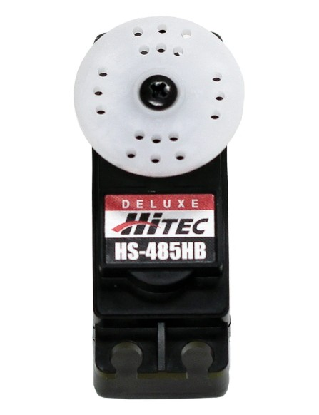
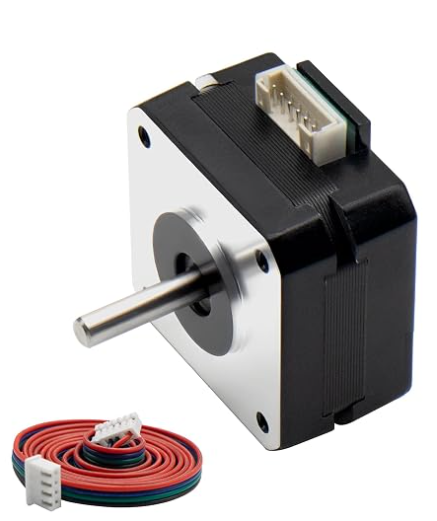
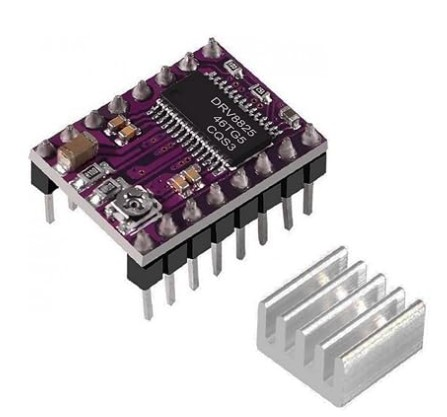

# Driver Nano 1 (Servo + Display)

This page covers the components for **Driver Nano 1**: the joint-1 servo and the diagnostic display. Driver Nano 1 receives target positions from the Main Processor Nano over the I2C, drives the joint, shows leg status on the display, and reports status back.

**Selection criteria used for both components**

* Runs from the 5 V logic domain used by the Nano.
* Has a manufacturer or available datasheet.
* Uses few Nano pins and little RAM.
* Does not use the Nano's hardware I2C pins (A4/A5), which are reserved for the command bus to the Main Nano.
  

---

**Hip Joint Servo (Rotary Actuator)**

1. Hitec HS-485HB standard analog servo

    

    * $28.99/each
    * [HS-485HB product page at Amzaon](https://a.co/d/0c83S3Ro)
    * [HS-485HB manufacturer datasheet](https://media.digikey.com/pdf/Data%20Sheets/Hi-Tech/HS-485HB.pdf)

    | Pros | Cons |
    | ---- | ---- |
    | Position control is built in: the internal potentiometer holds the commanded angle, so the Nano only outputs one 50 Hz PWM signal (Servo library, any digital pin) and no driver IC is needed. | Stall current is 1.0 A at 4.8 V and 1.2 A at 6 V per the datasheet, so the regulator and wiring must be sized for it, and the servo cannot be powered from the Nano's 5V pin or USB. |
    | Stall torque of 4.8 kgf·cm at 4.8 V and 6.0 kgf·cm at 6 V in a 45 g package gives the highest torque per gram of the three options. | Karbonite (plastic) gears can strip under shock loads such as a leg strike, and metal-gear servos cost more. |
    | It runs from the same 4.8–6 V range as the logic, and the manufacturer datasheet lists stall current, idle current, speed, and dimensions, which makes the power budget straightforward. | The servo gives no position output, so the Nano cannot confirm that the joint reached the angle. The status sent to the Main Nano is the commanded value, not a measured one. |

2. NEMA 17 bipolar stepper (17HS15-1704S) with DRV8825 stepper driver carrier

    

    * Motor: $9.98
    * [17HS4023S Stepper motor product page at Amazon](https://a.co/d/0dAFWEmr)
    * [17HS15-1704S full datasheet](https://www.laskakit.cz/user/related_files/73231_1624__ps_1199sm-17hs4023-etc.pdf)

    

    * Driver: $15.95
    * [DRV8825 driver product page at Pololu](https://www.pololu.com/product/2133)
    * [DRV8825 datasheet (Texas Instruments)](https://www.ti.com/lit/ds/symlink/drv8825.pdf)

    | Pros | Cons |
    | ---- | ---- |
    | The motor's rated current of about 0.7 A per phase is well under the DRV8825 carrier's roughly 1.5 A limit without a heat sink, so no extra cooling is needed. | Holding torque is only about 14 N·cm (roughly 1.4 kgf·cm), about a third of the HS-485HB's 4.8 kgf·cm at 4.8 V, so a gearbox would likely be needed for a hip joint, adding cost, backlash, and mass. |
    | The DRV8825 provides up to 1/32 microstepping from a 1.8° step motor, and the Nano only has to output STEP and DIR pulses with no PWM timing constraints. | The DRV8825 needs an 8.2–45 V motor supply (the motor is rated for 12 V), so it cannot run from the 5–6 V logic rail and adds a second power rail, regulator, and power budget line. |
    | The shaft holds position while the coils are energized with no gear train to strip, and the DRV8825 adds over-current protection, thermal shutdown, and an adjustable current limit. | It is open loop with no position feedback, so lost steps go undetected and the joint needs a homing switch at power-up, and the coils draw current continuously while holding. |

**Choice:** Option 1: Hitec HS-485HB standard servo

**Rationale:** The HS-485HB is the best match for the Driver Nano 1 architecture. Its internal closed-loop position control means the Nano only needs one PWM pin and the standard Servo library, and it runs from the same 4.8–6 V supply as the rest of the subsystem. The stepper option (Option 2) is the most inexpensive motor, but the DRV8825 needs at least 8.2 V, which forces a second power rail and regulator, and the 280 g motor is about six times heavier than the servo for similar torque. 

---

**Diagnostic Display (leg status)**

1. 0.96" 128×64 monochrome OLED module, SSD1306 controller (Amazon listing)

    

    * **TODO: $X.XX/each (copy from the listing)**
    * [0.96" SSD1306 OLED module on Amazon](https://a.co/d/06kDryth)
    * **TODO: add a link to the SSD1306 controller datasheet or the datasheet in the listing (required for Amazon parts).**

    | Pros | Cons |
    | ---- | ---- |
    | The I2C version needs only four wires (VCC, GND, SDA, SCL), which uses very few Nano pins. | The listing must provide a datasheet or detailed specifications, and the module's board layout (pin order, on-board regulator) can vary between sellers, so the listing must be checked before wiring. |
    | The panel emits its own light, giving high contrast with no backlight, and current draw is tens of mA depending on how many pixels are lit. | OLED pixels dim with age and burn in if the same content is shown for thousands of hours, so the screen should be turned off when idle. |
    | 128×64 pixels shows several lines of status (commanded angle, measured status, fault flags) or a simple graphic. | The Adafruit_SSD1306 library keeps a 1 KB frame buffer, half of the Nano's 2 KB SRAM, so the U8g2 library in page-buffer mode (about 128 bytes) should be used instead. |
    | U8g2 supports software I2C on any two digital pins, so the display can avoid the hardware I2C pins (A4/A5) used for the command bus to the Main Nano. | At 0.96" diagonal the text is small, which limits readability from a distance. |
    | It is the most inexpensive way to get a graphic display, and both U8g2 and Adafruit_SSD1306 are well documented. | Software I2C is slower than hardware I2C, although this is not a problem for a status screen. |

2. Adafruit 0.96" 128×64 monochrome OLED, STEMMA QT (ADA326)

    

    * $17.50/each (quantity 1–9)
    * [Adafruit 0.96" OLED (ADA326) product page](https://www.adafruit.com/products/326)
    * [Adafruit monochrome OLED datasheets and design files](https://learn.adafruit.com/monochrome-oled-breakouts/downloads)

    | Pros | Cons |
    | ---- | ---- |
    | Adafruit publishes datasheets, EagleCAD PCB files, and a full tutorial, which satisfies the course datasheet requirement without extra searching. | It costs $17.50, which is more than a generic module with the same SSD1306 panel. |
    | The revised board has auto-reset circuitry, so the RESET pin is not needed, and I2C is the default configuration. | The pins are not pre-soldered for breadboard use: it needs a STEMMA QT cable or soldered headers. |
    | The STEMMA QT connectors allow plug-in wiring without soldering. | It has the same 1 KB frame-buffer cost as other SSD1306 modules when using the Adafruit library. |
    | Adafruit's library and tutorial are the reference implementation for the SSD1306. | It is the same panel as Option 1, so it adds no display capability. |

3. Adafruit Standard 16×2 character LCD, HD44780, white on blue (ADA181)

    

    * **TODO: $X.XX/each**
    * [Adafruit Standard LCD 16×2 (ADA181) product page](https://www.adafruit.com/product/181)

    | Pros | Cons |
    | ---- | ---- |
    | Adafruit provides a datasheet with pin locations and the HD44780 command-set datasheet. | It is text-only (16 characters × 2 rows), so it cannot show graphics or a compact status layout. |
    | The single-row 0.1" header suits breadboards and through-hole boards. | It needs six Nano digital lines in 4-bit mode (versus two for an I2C OLED). Adding the I2C backpack would reduce the pins but add cost and put it on the I2C bus. |
    | The LiquidCrystal library ships with the Arduino IDE and uses very little RAM, so it avoids the OLED frame-buffer issue. | A contrast potentiometer and backlight resistor are needed, and the backlight draws current continuously. |
    | The blue LED backlight can be dimmed with a resistor or PWM and uses much less power than EL backlights. | The module is physically larger than the OLED. |

**Choice:** Option 1: 0.96" 128×64 SSD1306 OLED module

**Rationale:** The OLED can show multiple lines of leg status (commanded angle, measured status, fault flags) and simple graphics, which the 16×2 LCD cannot. It needs only two signal pins, whereas the LCD needs six. Using the U8g2 library in page-buffer mode on software I2C (pins D4/D5) solves two Nano problems at once: it keeps only about 128 bytes of RAM in use, and it leaves the hardware I2C pins (A4/A5) free as the command bus to the Main Nano. The Adafruit module (Option 2) is the same panel at a higher price, so it is kept as the fallback if the Amazon listing does not provide a datasheet. **TODO: confirm the Amazon listing includes a datasheet or detailed specifications.**

---

**Pin Table (draft, Driver Nano 1)**

| Nano pin | Function | Connects to |
| -------- | -------- | ----------- |
| D9 | Servo signal (50 Hz PWM, Servo library) | HS-485HB signal wire |
| D4 | OLED SDA (software I2C, U8g2) | OLED SDA |
| D5 | OLED SCL (software I2C, U8g2) | OLED SCL |
| A4 | Hardware I2C SDA (command/feedback bus) | Main Processor Nano |
| A5 | Hardware I2C SCL (command/feedback bus) | Main Processor Nano |
| 5V / GND | Logic power for the Nano and OLED | Regulated 5 V rail |
| (external) | Servo power, 6 V rail, sized for 1.2 A stall | HS-485HB power wire, common ground with the Nano |

If the stepper option is chosen instead: D2 = STEP, D3 = DIR, D6 = ENABLE, D7 = nFAULT (input), with the motor supply (8.2 V or higher) on the DRV8825 VMOT pin.
