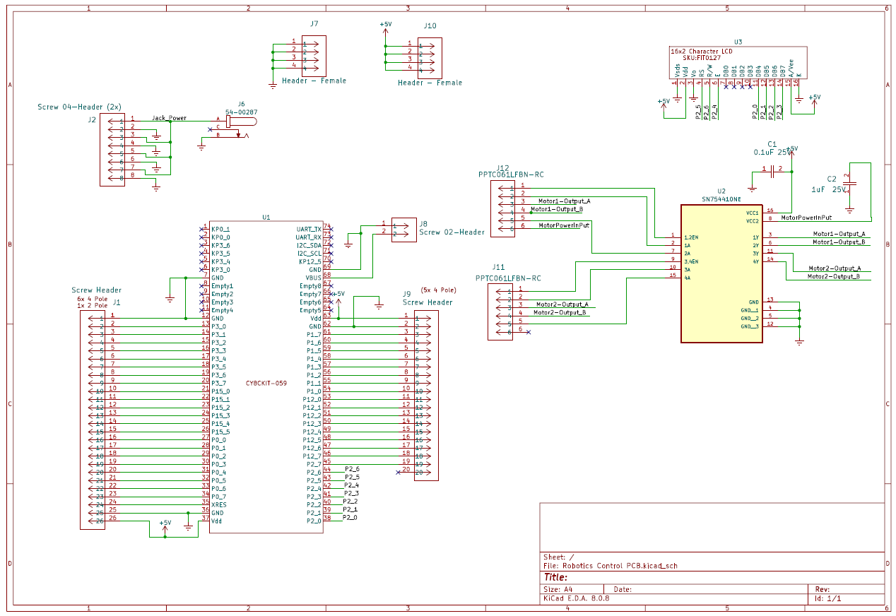

## Overview

This schematic is design for the individual subsystem part of the team's Spider Leg Portion.

{style width:"350" height:"300;"}
**Figure ##:** Schematic of my subsystem of the group project.

## Resouces

The schematic as a PDF download is available [*here*](ExampleSchematic.pdf), and the Zip folder of the project [*here*](dummyZip.zip).
