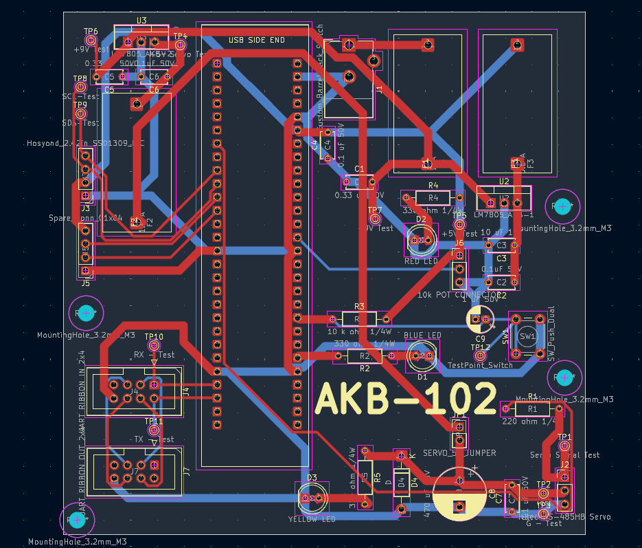
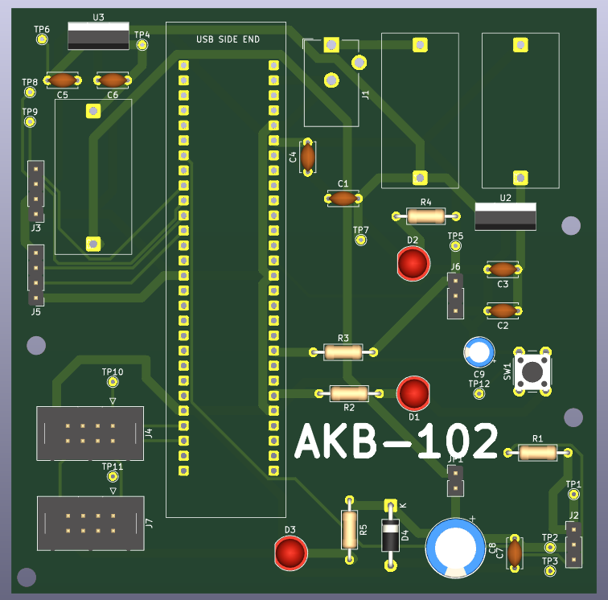
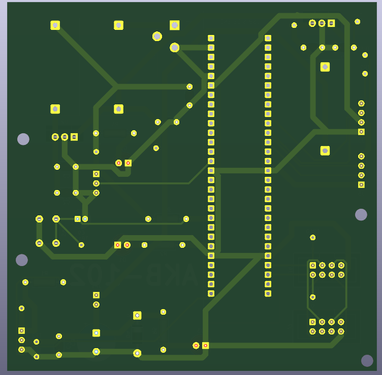
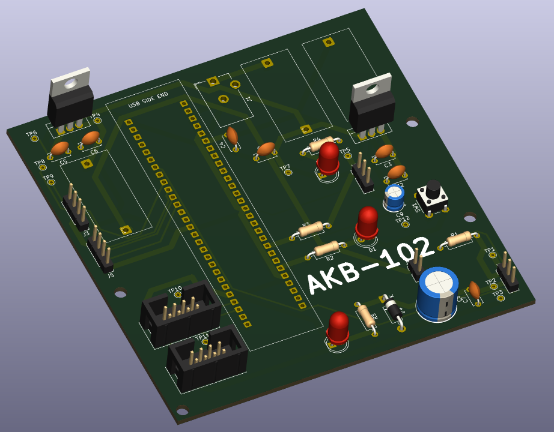

# PCB Design

## Final PCB Layout

The PCB was designed in KiCad and measures approximately 99 mm × 99 mm.

## Front Copper Layer

## Back Copper and Ground Plane

The back copper layer contains the Earth ground plane and other pins.

## 3D PCB View

