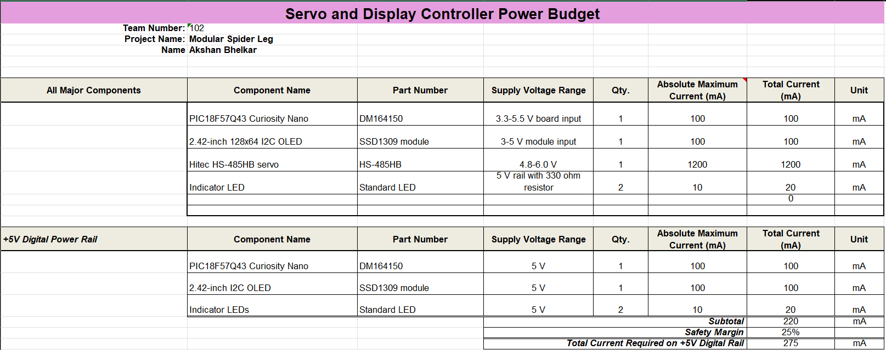
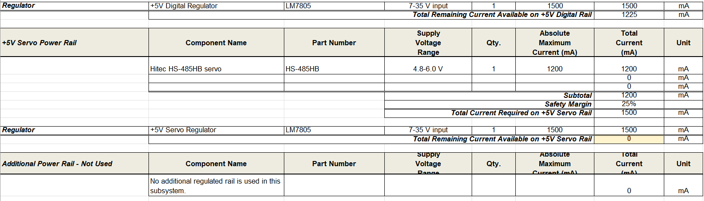
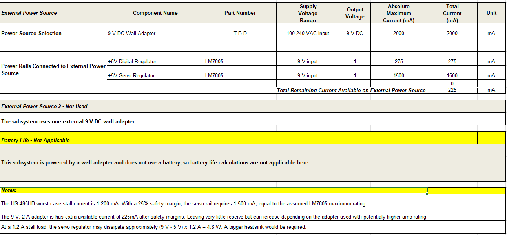

## Overview

{style width:"350" height:"300;"}

{style width:"350" height:"300;"}

{style width:"350" height:"300;"}

## Conclusions

The HS-485HB worst case stall current is 1,200 mA. With a 25% safety margin, the servo rail requires 1,500 mA, equal to the assumed LM7805 maximum rating.						

## Resouces

The power budget as a PDF download is available [*here*](Akshan_Bhelkar_Power_Budget.pdf), and a Microsoft Excel Sheet [*here*](Akshan_Bhelkar_Power_Budget.xlsx).

